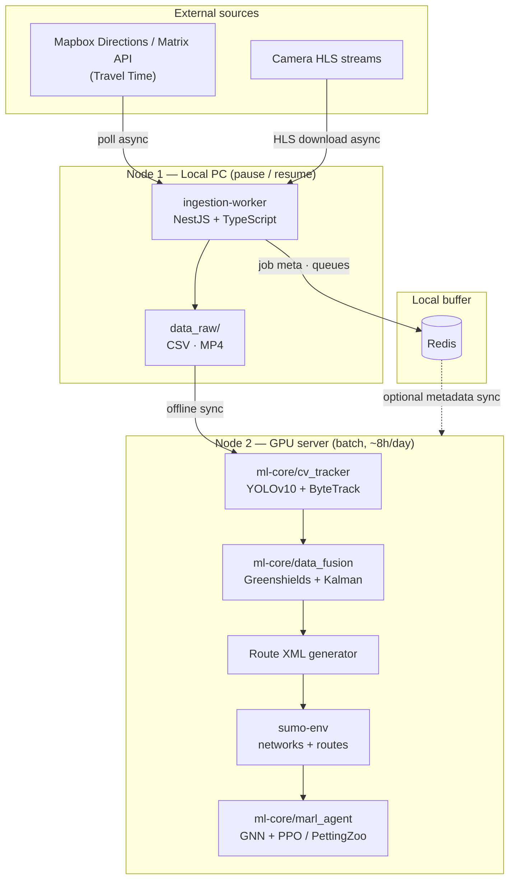
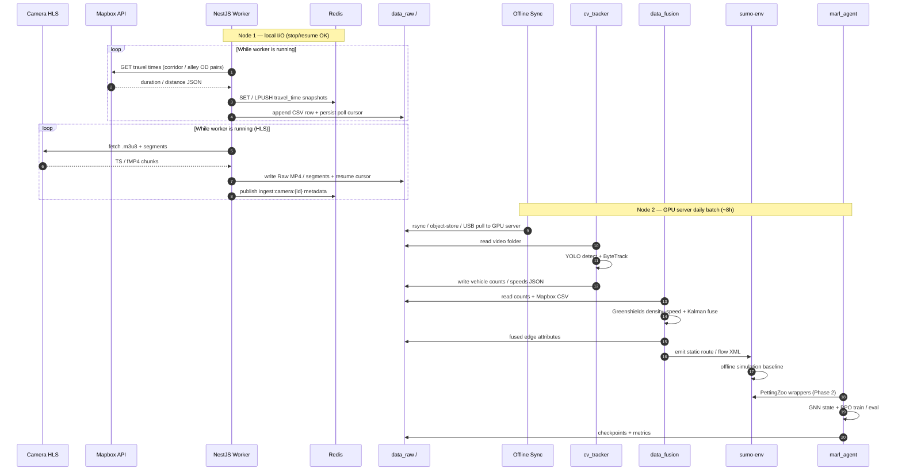
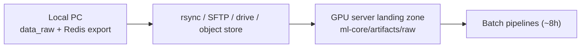

# Architecture — HCMC Urban Traffic Optimization

## North star

Mọi quyết định kiến trúc phải phục vụ:

> **Tái tạo môi trường giao thông có hẻm** — mỗi hẻm có **định danh đồ thị**, **cấu trúc**, và **mật độ `k(t)` nội suy** — đủ tốt để MARL học định tuyến linh hoạt.

- **Twin layers:** `alley_id` (canonical graph) + structure attrs + density `k(t, alley_id)` (và `v` suy ra).
- **MARL I/O:** `(t, O, D) → shortest travel time` (route **được phép qua hẻm**); observation = graph state tại `t`.
- Crawl / CV = quan sát thưa; **`data_fusion` nội suy** mật độ cho hẻm mù — không phải sản phẩm cuối.
- Chất lượng twin (ID ổn định + `k` trên hẻm) > độ “đẹp” của pipeline trung gian.

## Design principles

1. **Physical & temporal split:** Node 1 (máy local) là I/O, chạy khi bạn bật worker — **pause / resume** được; Node 2 (GPU server) là compute-bound, cửa sổ ~8h/ngày.
2. **Async I/O on Node 1:** NestJS uses `async/await` for Mapbox polling and HLS segment writes — no blocking disk/network in the event loop. State resume (last poll, last segment) phải durable.
3. **Batch-only on Node 2:** Every Python entrypoint is `read → process → write`. No real-time wait loops.
4. **Artifact contract:** Redis buffers short-lived state trên máy local; durable truth is CSV/MP4/JSON/XML on disk (sync **Local PC → GPU server**).

## Logical nodes

## End-to-end data flow (Phase 1 → Phase 2)

## Component responsibilities

### `ingestion-worker/` (NestJS)

| Concern | Behavior |
|---------|----------|
| Mapbox poller | Scheduled async jobs; rate-limit aware; write CSV + Redis keys |
| Camera crawler | HLS playlist resolve → segment download → concatenate / store Raw |
| Redis | Job queues, last-success timestamps / resume cursors, short TTL caches |
| `data_raw/` | Staging on local disk; rotate / sync out to GPU server before Node 2 batch |

### `ml-core/` (Python)

| Package | Batch I/O contract |
|---------|-------------------|
| `cv_tracker/` | `--input` video dir → `--output` count/track artifacts |
| `data_fusion/` | counts + Mapbox CSV → fused speeds/densities + SUMO-ready tables |
| `marl_agent/` | SUMO net/routes + fused state → trained policies / eval logs |

### `sumo-env/`

- `networks/` — `.net.xml` from OSMnx (or netconvert) for the alley subgraph.
- `routes/` — static O-D / route XML produced by fusion (Phase 1) and later by MARL policies (Phase 2).

### `docker-compose.yml`

- **Redis:** required for local Node 1 development.
- **OSRM:** optional `routing` profile for baseline shortest-path checks (not a substitute for alley Digital Twin fusion).

## Sync boundary (Local PC → GPU server)

Recommended cadence: sync khi Node 1 đã gom đủ raw (hoặc trước cửa sổ compute hàng ngày); Node 2 never waits on live NestJS. Gaps do tắt máy local được chấp nhận — fusion phải chịu missing windows.

## Non-goals (enforced)

- Real-time inference loop on the GPU server.
- Mixing NestJS modules into `ml-core/` or Python into `ingestion-worker/src`.
- Treating Mapbox travel time alone as ground truth for alleys (it is one observation fused with CV counts).
- Assuming Node 1 is 24/7 VPS (current deployment = local, resumable).

## Evolution

- **Phase 1:** NestJS ingest → CV counts → Greenshields + Kalman → static SUMO routes (Digital Twin baseline).
- **Phase 2:** PettingZoo multi-agent env over SUMO; GNN + PPO bidding / flexible routing.

See [PHASES.md](./PHASES.md) for task lists and [PROGRESS.md](./PROGRESS.md) for status.
