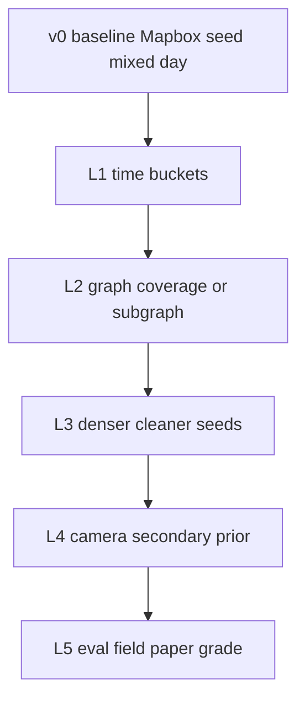

# Nâng cấp môi trường Twin Quận 4 — L1 → L5

> Mục tiêu: sau baseline train **v0**, cải tiến **cực sâu** data/`k(t)` để paper đứng được.  
> Trainer giữ nguyên; mỗi lớp xong → bump `experiment.data_tag` (v1, v2, …) → train lại so sánh với v0.

## Nguyên tắc khóa

1. **Nguồn chính trong hẻm = Mapbox OD seed + nội suy đồ thị.**  
2. **Camera không chiếu vào hẻm** → chỉ **nội suy thứ cấp** (cổng/trục gần hẻm), không bao giờ thay observed trong hẻm.  
3. Không đổi `obs_mode=compact` / action space giữa các version nếu tránh được → so sánh công bằng.  
4. Mỗi lớp có **Pass checklist** + **data_tag** trước khi đốt H100.

---

## L1 — Tách `k(t)` theo khung giờ (ưu tiên #1)

**Vấn đề:** `alley_density_latest` đang fuse cả ngày (sáng+tối) → một `k` giả.

### Việc làm
1. Sửa `run_quan4_density` (hoặc wrapper):  
   - Filter `duration_sec > 0`.  
   - Group Mapbox CSV theo `timestamp[:13]` (UTC hour) hoặc giờ VN.  
   - Xuất `alley_density_<bucket>.json` **riêng** từng peak (vd. `T00`–`T04` sáng, `T11`–`T13` tối UTC).  
2. Không ghi đè “latest” bằng mix; `latest` = bucket mới nhất **một** peak, hoặc symlink rõ ràng.  
3. Trainer: map `t` (sec of day) → bucket density file (load đúng file khi eval/train).  
4. Bump `data_tag: v1_time_bucket`.

### Pass
- [ ] ≥2 bucket peak trong 1 ngày có file riêng  
- [ ] Không còn fusion trộn sáng+tối trong cùng một file dùng để train  
- [ ] Infer cùng OD lúc `t=8h` vs `t=18h` cho `k`/travel khác nhau có giải thích được  

### Effort
1–2 ngày local · 0 GPU · sau đó 1 buổi H100 so v0 vs v1.

---

## L2 — Phủ density vs miền train (ưu tiên #2)

**Vấn đề:** ~42% edge graph không có `k` → MARL default; graph 370 WCC.

### Chọn một hướng (đừng làm nửa vời)

**L2-A — Phủ đủ cạnh routable (trong WCC lớn nhất)**  
1. Chạy nội suy/prior Greenshields cho mọi edge trong weakly-connected component lớn nhất.  
2. Tag `source`: `observed` | `interpolated` | `prior`.  
3. Uncertainty: observed < interpolated < prior.

**L2-B — Cắt subgraph train (nhanh, sạch claim “alley twin”)**  
1. Lấy WCC lớn nhất ∩ (alley layer ∪ neighbors 1-hop nếu cần connectivity).  
2. Export `alley_graph_wcc.json` + density subset.  
3. Seeds/OD chỉ trong subgraph.  
4. Config trỏ graph/density mới.

### Pass
- [ ] 0 edge trên path train/val/test dùng default `k` im lặng (hoặc log cảnh báo = 0)  
- [ ] `data_tag: v2_fullcover` hoặc `v2_wcc_subgraph`  
- [ ] Số WCC dùng cho train = 1 (hoặc documented)

### Effort
2–4 ngày · rồi 1 buổi H100 so với v1.

---

## L3 — Seed dày / sạch hơn (vẫn Mapbox-first)

**Vấn đề:** observed 2.1%; một số OD toàn zero; uncertainty phẳng.

### Việc làm
1. Nest thêm 1–2 ngày **đúng peak** (7–9 & 17–20 VN), gentle batch giữ nguyên.  
2. Sample seed mới **300–500** chỉ trong miền L2 (không rải mù 5k).  
3. Pipeline: drop `duration≤0`; yêu cầu ≥3 mẫu dương / OD trước khi gọi là observed.  
4. Uncertainty = f(n_samples, hop_distance_to_observed).  
5. `data_tag: v3_seed400` (số thực tế).

### Pass
- [ ] Observed alleys ≥ 300 (hoặc ≥5% alley layer trong WCC)  
- [ ] `only_zero` OD &lt; 5% seed  
- [ ] Uncertainty ≥ 3 mức phân biệt được  
- [ ] Bảng ablation v0/v1/v2 vs v3 trên cùng test OD

### Effort
2–4 ngày Nest + 1 ngày fusion · 1–2 buổi H100.

---

## L4 — Camera như prior thứ cấp (không thay hẻm)

**Ràng buộc:** camera **không nhìn vào trong hẻm** → không gán count trực tiếp làm `k` trong hẻm.

### Vai trò đúng
- Quan sát **cổng hẻm / đoạn trục / ngã tư** gần entry OSM.  
- Sinh **boundary prior** hoặc hệ số điều chỉnh nhẹ cho cạnh `service`/`residential` **giáp** camera.  
- Kalman: Mapbox (trong hẻm) = primary; camera (tại cửa) = secondary measurement với `R` lớn hơn (tin kém hơn trong hẻm).

### Việc làm
1. Map thủ công/bán tự động: `cam_id → nearest spine/entry node` (không map vào giữa hẻm).  
2. CV batch → count/occupancy tại frame.  
3. Đổi sang mật độ/tải **cạnh cửa**; lan truyền vào hẻm tối đa 1–2 hop với decay mạnh.  
4. Ablation bắt buộc: `Mapbox-only` vs `Mapbox+cam_secondary`.  
5. `data_tag: v4_cam_secondary`.

### Pass
- [ ] Paper/docs ghi rõ: camera không observe interior alley  
- [ ] Không có alley_id “giữa hẻm” mang `source=camera_direct`  
- [ ] Ablation: cam secondary không làm xấu val nếu nhiễu (hoặc cải thiện nhẹ cổng)

### Effort
1–2 tuần (gắn cam–edge là phần khó) · 1–2 buổi H100 ablation.

---

## L5 — Đánh giá / twin mức paper

**Vấn đề:** thiếu protocol so sánh ổn định và limitation trung thực.

### Việc làm
1. **Frozen test suite:** cố định `od_split` test + list `t` + data_tag; không đổi khi tune.  
2. Bảng chuẩn mỗi version: test_travel, oracle, regret, action_acc, wall-clock H100.  
3. Figure: map `k` theo bucket; histogram regret; learning curve từ `metrics.jsonl`.  
4. SUMO: vài route từ policy vs static (định tính).  
5. Limitation section sẵn: OSM thiếu hẻm, Mapbox ≠ probe xe máy trong hẻm hẹp, cam không vào hẻm, graph fragmentation.  
6. `data_tag` gắn vào mọi bảng paper.

### Pass
- [ ] Repro: 1 lệnh train + 1 lệnh bảng metrics từ `summary.json`  
- [ ] ≥3 data_tag so sánh được (vd. v0, v1, v3)  
- [ ] Checklist ethics/limitation trong draft paper

### Effort
Song song viết paper · 2–4 ngày + GPU đã có từ các lớp trước.

---

## Lịch gợi ý (sau khi train v0 xong)

| Tuần | Việc | data_tag | H100 |
|------|------|----------|------|
| 0 | Train baseline | `v0_seed120_mixed_day` | 1–2 buổi |
| 1 | L1 + (L2-A hoặc L2-B) | `v1_…` → `v2_…` | 1–2 buổi |
| 2 | L3 Nest + fuse | `v3_…` | 1–2 buổi |
| 3–4 | L4 cam secondary (nếu đủ thời gian) | `v4_…` | 1–2 buổi ablation |
| Song song | L5 bảng + figure + limitation | — | — |

---

## Không làm

- Coi camera là ground-truth trong hẻm.  
- Train 10 buổi H100 trên v0 rồi mới sửa L1.  
- Đổi obs dim / action giữa version mà không đổi tên experiment.  
- Sample 5000 OD Mapbox cùng lúc (cháy quota, không tăng chất lượng tuyến tính).

---

## Liên kết

- Train ngay: [TRAIN_NOW.md](./TRAIN_NOW.md)  
- Chi tiết trainer: [TRAIN_SERVER.md](./TRAIN_SERVER.md)  
- Density hiện tại: [QUAN4_DENSITY.md](./QUAN4_DENSITY.md)
