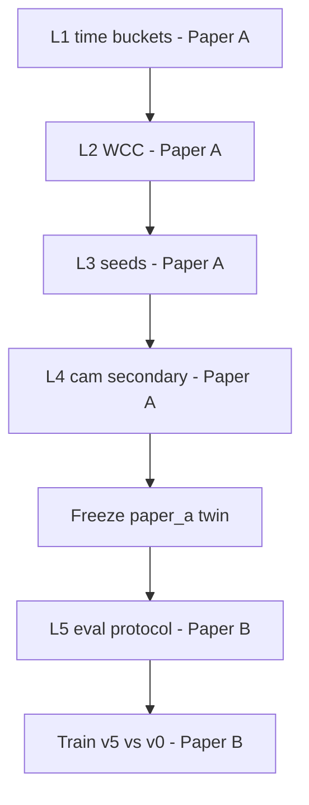

# Nâng cấp môi trường Twin Quận 4 — L1 → L5

> Pipeline kỹ thuật phục vụ **hai bài báo** — xem [RESEARCH_TWO_PAPERS.md](./RESEARCH_TWO_PAPERS.md).  
> **Paper A (data/twin):** L1–L4 + freeze artifact. **Paper B (tối ưu hẻm):** L5 protocol + **một** train GPU trên twin đã freeze.  
> **Không** train lại sau mỗi L.

## Nguyên tắc khóa

1. **Nguồn chính trong hẻm = Mapbox OD seed + nội suy đồ thị.**  
2. **Camera không chiếu vào hẻm** → chỉ **nội suy thứ cấp** (cổng/trục gần hẻm).  
3. Không đổi `obs_mode=compact` / action space giữa version nếu tránh được.  
4. Mỗi lớp: Pass checklist; **GPU chỉ cho Paper B** sau freeze Paper A.  
5. Giữa các L: smoke CPU / JSON QA — không `robust_train` full.

---

## L1 — Tách `k(t)` theo khung giờ (**Paper A**)

**Vấn đề:** `alley_density_latest` fuse cả ngày → một `k` giả.

### Việc làm (đã code)
1. `run_quan4_density.py --l1-peaks`: filter `duration_sec > 0`; peaks UTC morning / afternoon / evening.  
2. `alley_density_latest` = **một** peak.  
3. Trainer catalog: `ensure_density_for_t`.  
4. Config nháp gộp vào `quan4_v5_final.yaml`.

### Pass (Paper A)
- [x] ≥2 peak file riêng (afternoon + evening observed)  
- [ ] Morning observed > 0 (**việc tiếp theo — poll sáng**)  
- [x] Không mix sáng+tối trong một file train  
- [ ] Báo cáo afternoon vs evening `|Δk|` trung thực  

### Effort
0 GPU · còn morning poll + (optional) thêm ngày.

---

## L2 — WCC subgraph (**Paper A**)

Code: `python -m data_fusion.export_wcc_subgraph` (alley-core + hop1 + final WCC cut).

### Pass
- [x] `pass_single_wcc: true`  
- [x] Density cover + prior-fill trong WCC  
- [x] Seeds WCC non-empty  

---

## L3 — Seed dày / uncertainty (**Paper A**)

`sample_od_seeds --n 400` trong WCC; `--min-positive 3`; `verify_l3`.

### Pass
- [x] Observed ≥ 300 / ~26% trong WCC (379)  
- [x] only_zero ≤ ~5–6% sau drop seed chết  
- [x] Uncertainty ≥ 3 mức  

---

## L4 — Camera secondary (**Paper A** method; **Paper B** ablation)

`cam_secondary_prior.py` — map cam→node, 1–2 hop, cấm `camera_direct`.

### Pass
- [x] Smoke: `pass_no_camera_direct`, alleys_touched > 0  
- [ ] Cam Q4 thật (optional, mạnh cho A)  

---

## L5 — Eval + config train cuối (**Paper B**)

1. `quan4_v5_final.yaml` (`data_tag: v5_l1l5`)  
2. `l5_metrics_table`  
3. [L5_LIMITATIONS.md](./L5_LIMITATIONS.md)  

### Pass
- [x] Repro docs  
- [ ] Train full sol1 + bảng v0 vs v5  
- [x] Limitation draft  

---

## Lịch (khớp 2 paper)

| Giai đoạn | Việc | Paper | GPU |
|-----------|------|-------|-----|
| Done | L2–L4 + afternoon/evening | A | 0 |
| Now | Morning poll + fuse + freeze twin | A | 0 |
| Next | Train `v5_l1l5` vs v0 trên sol1 | B | 1–2 buổi |
| Write | Draft A rồi B (cite A←B) | A+B | — |

---

## Không làm

- Camera = GT trong hẻm.  
- Train sau mỗi L.  
- Hai abstract copy-paste cùng contribution.  
- Sample 5000 OD một lúc.

---

## Liên kết

- **Kế hoạch 2 paper:** [RESEARCH_TWO_PAPERS.md](./RESEARCH_TWO_PAPERS.md)  
- Train Paper B: [TRAIN_NOW.md](./TRAIN_NOW.md)  
- Density: [QUAN4_DENSITY.md](./QUAN4_DENSITY.md)
