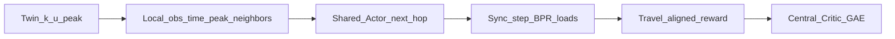

# One paper (locked) — MAPPO micro next-hop alley routing (Quận 4)

> **Main claim:** MAPPO (CTDE) đa agent chọn **cạnh kế (micro)** trên twin hẻm + BPR congestion.  
> Macro K-path / UAKP / binary → **legacy**; micro v1 full run **không đạt** pass (xem audit).

## Bài toán

N=16 agent; mỗi bước chọn **1 outgoing edge** (masked); horizon tới đích / `max_steps`.  
OD lọc **≥6 hops và ≥400 m**. Time trong state: `t_norm` + **peak one-hot** + density peak.  
Eval: fleet mean/CVaR **và arrival_rate** vs Dijkstra / random / greedy-load next-hop.

## Artifact

| | |
|--|--|
| Config | `quan4_mappo_micro.yaml` (`mappo_micro_v2b`) |
| Env / train | `mappo_micro_env.py`, `mappo_micro_train.py` |
| Audit | `python -m marl_agent._audit_v1_failure` |
| Sol1 | [SOL1_MAPPO.md](./SOL1_MAPPO.md) |

## v1 run (sol1) — facts

From summary `mappo_micro_v1` seed42:

| policy | fleet_mean | congestion |
|--------|------------|------------|
| greedy | 912 | 0.94 |
| random | 2126 | 2.08 |
| Dijkstra | 5410 | 2.57 |
| MAPPO test | 5517 | **57.8** |

Early-stop best val ~4038 @ update 50. MAPPO không thắng baseline trên fleet.

## Evidence sau audit (local, cùng OD filter)

`python -m marl_agent._audit_v1_failure` + đo `true_arr` (tới đích thật, không tính truncate-forced done):

| policy | fleet (approx) | true arrival /16 | hit horizon |
|--------|----------------|------------------|-------------|
| Dijkstra | ~4–6k | **~1.0** | finishes ~66 steps |
| random | low on old metric / high after fair truncate | **~0** | always horizon |
| greedy | looked best on old fleet | **~0.12–0.18** even at max_steps 400 | loops / local minima |
| always action0 | extreme | 0 | collapse signature |

**Kết luận có bằng chứng:**

1. **Metric cũ lệch:** so `fleet_mean` với random/greedy không công bằng — chúng gần như không tới đích; Dijkstra chịu BPR nhưng **arrival=1**.
2. **Greedy không phải “baseline mạnh” theo arrival** — tăng horizon lên 400 cũng không cứu (arr~0.18). BC clone greedy có thể hại.
3. MAPPO v1 cong~58 cùng hướng với policy xấu (action0), nhưng **chưa chứng minh** cơ chế collapse cụ thể từ log entropy.
4. Team-mean reward **không tự động sai** (MAPPO paper dùng shared reward); per-agent GAE = thí nghiệm.

**Giả thuyết còn mở** (có code, chưa có full retrain chứng minh): live occupancy; BC **Dijkstra**; reward shaping.

## v2b chỉnh theo audit

- `max_steps: 200`; truncate fail floor lớn; `arrival_rate` trong eval/summary
- BC teacher mặc định **`dijkstra`** (không greedy)
- Pass chính: `beats_dijkstra_fair` (fleet + arrival), không phải “thắng random trên fleet”

## Pass (cập nhật)

- [ ] `MAPPO_MICRO_ENV_TESTS_OK`
- [ ] Full sol1 → `MAPPO_MICRO_TRAIN_OK` (`mappo_micro_v2b`)
- [ ] `beats_dijkstra_fair`
- [ ] Ablation `--ippo` (sau baseline v2b)
- [ ] Limitations trung thực (BPR, metric, greedy arrival yếu)
