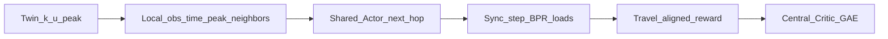

# One paper (locked) — MAPPO micro next-hop alley routing (Quận 4)

> **Main claim:** MAPPO (CTDE) đa agent chọn **cạnh kế (micro)** trên twin hẻm + BPR congestion.  
> Macro K-path / UAKP / binary → **legacy appendix** (quá dễ hoặc thua greedy trên travel).

## Bài toán

N=16 agent; mỗi bước chọn **1 outgoing edge** (masked); horizon tới đích / `max_steps`.  
OD lọc **≥6 hops và ≥400 m**. Time trong state: `t_norm` + **peak one-hot** + density peak.  
Reward: **travel-dominant** (+ mild congestion/risk). Eval: fleet mean/CVaR vs Dijkstra / random / greedy-load next-hop.

## Vì sao micro

Macro K-path nhốt policy trong menu path; greedy tuần tự thắng travel.  
Micro = điều hướng thật, đổi hướng theo load/local obs, time/peak có đất diễn.

## Artifact

| | |
|--|--|
| Config | `quan4_mappo_micro.yaml` (`data_tag: mappo_micro_v2`) |
| Env / train | `mappo_micro_env.py`, `mappo_micro_train.py` |
| Sol1 | [SOL1_MAPPO.md](./SOL1_MAPPO.md) |
| Outline | [PAPER_OUTLINE_MAPPO.md](./PAPER_OUTLINE_MAPPO.md) |
| Legacy | macro K-path; **v1 micro** (no live load / team-mean GAE) |

## v1 fail → v2 fixes

v1 test ~5517s, cong~58, thua random/Dijkstra/greedy. Root causes:
1. Obs chỉ `bg_load` — không thấy agent khác (greedy thì có live load).
2. Train dùng **team-mean reward** → mọi agent cùng advantage.
3. Không warm-start → collapse sớm (best @50).

v2: live occupancy + edge load trong obs/critic; **per-agent GAE**; BC greedy warm-start; `w_C`/progress/revisit; `compact_dim=160`.

## Pass

- [ ] `MAPPO_MICRO_ENV_TESTS_OK`  
- [ ] Full sol1 → `MAPPO_MICRO_TRAIN_OK` (`mappo_micro_v2`)  
- [ ] `beats_dijkstra_mean` và **`beats_random_mean`** (ideal: gần / thắng greedy)  
- [ ] Ablation `--ippo`  
- [ ] Limitations trung thực (BPR stylized, Mapbox twin)  
