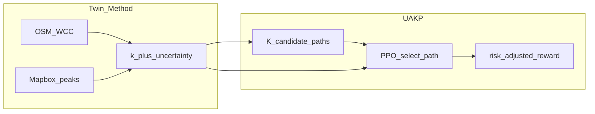

# One paper (locked) — Uncertainty-aware alley routing (Quận 4)

> **Research lock:** một conference paper. Twin hẻm + UAKP dính một claim.  
> Phase hai-paper / binary “MARL” cũ → **legacy** (không còn claim chính).  
> Plan kỹ thuật: UncertaintyAwareKPath (UAKP).

---

## Bài toán

Cho `(t, O, D)` trên mạng hẻm Quận 4 (largest alley-core WCC), với mật độ `k` quan sát thưa và **uncertainty** theo cạnh: học policy chọn một path trong tập ứng viên để giảm thời gian đi **có tính rủi ro cạnh không chắc**.

### Ràng buộc (scope)

| | |
|--|--|
| Domain | Largest alley-core WCC (~886 nodes / ~1.8k edges), không full city 370 WCC |
| Data | Mapbox OD seeds + graph interpolation; camera = secondary cổng/spine |
| Agent | Single decision-maker (routing recommendation) — **không** multi-agent congestion |
| Action | Chọn 1 trong **K≥6** candidate paths — **không** binary prefer-main/alley |

### Giới hạn (viết vào paper)

- Mapbox duration ≠ probe xe máy trong hẻm hẹp  
- OSM thiếu / tag lệch hẻm  
- Cam seed ít phủ interior Q4  
- Twin offline theo peak, không real-time closed-loop  
- Không claim field GPS ground truth  

### Một claim

> Trên twin hẻm có uncertainty, policy chọn trong tập path ứng viên (obs có uncertainty + reward risk-sensitive) giảm expected / risk-adjusted travel time so với baseline chắc chắn-mù và heuristic prefer-alley/main.

### Không còn mục tiêu

- Chứng minh MAPPO / multi-agent  
- Hai paper tách A/B  
- Coi `regret=0 / acc=100%` của binary v5 là kết quả chính  

Venue mặc định: ITSC / IEEE ITS workshop.

---

## Đóng góp

1. **Twin method:** OSM alley identity + WCC + Mapbox time-bucket fusion + uncertainty đa mức (+ cam secondary tùy chọn).  
2. **UAKP:** K-path candidates + compact obs `(OD, t, k-stats, u-stats, per-path feats)` + PPO + risk-sensitive reward.  
3. **Eval khoa học:** baselines non-RL + ablation ±uncertainty ±λ + gap-to-oracle-K (không action-acc binary).

---

## Artifact / config

| Vai trò | Path |
|---------|------|
| Twin WCC + peaks | `ml-core/artifacts/out/quan4/wcc/` |
| Seeds | `ingestion-worker/config/od_pairs.quan4.seeds_l3.json` |
| **Train chính** | `marl_agent/configs/quan4_uakp.yaml` (`data_tag: uakp_v1`) |
| Env / train | `marl_agent/uakp_env.py`, `marl_agent/uakp_train.py` |
| Legacy binary | `marl_agent/configs/quan4_v5_final.yaml` — chỉ so sánh toy / regression |
| Limitations | [L5_LIMITATIONS.md](./L5_LIMITATIONS.md) |
| Sol1 | [SOL1_UAKP.md](./SOL1_UAKP.md) |
| Outline | [PAPER_OUTLINE_UAKP.md](./PAPER_OUTLINE_UAKP.md) |

**data_tag:** `uakp_v1` trên twin đã freeze.

---

## Pass checklist (nộp)

- [ ] Twin: ≥2 peak observed; WCC single; uncertainty ≥3 mức  
- [ ] Unit tests UAKP: K>1; oracle ≠ random; λ>0 đổi ranking khi `u` đổi  
- [ ] Full train sol1 `quan4_uakp` → `UAKP_TRAIN_OK`  
- [ ] Stochastic CVaR90: policy vs Dijkstra vs random (metric uncertainty-aware)  
- [ ] Ablation: ±u trong obs; λ=0 vs λ>0 (bảng)  
- [ ] Baselines: Dijkstra-mean, prefer-alley/main, random-K, oracle-K + stoch table  
- [ ] Figures: map k/u; schematic; learning curve; ablation bars  
- [ ] Limitations section đầy đủ  

---

## Legacy

- [RESEARCH_TWO_PAPERS.md](./RESEARCH_TWO_PAPERS.md) — kế hoạch cũ (hai paper); **superseded** bởi doc này.  
- Binary PPO `v5_l1l5`: giữ code/run để đối chiếu “bài quá dễ”, không đưa làm main result.
