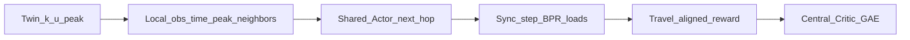

# One paper (locked) — MAPPO micro next-hop alley routing (Quận 4)

> **Main claim:** MAPPO (CTDE) đa agent chọn **cạnh kế (micro)** trên twin hẻm + BPR congestion.  
> Macro K-path / UAKP / binary → **legacy**; micro v1 full run **không đạt** pass (xem audit).

## Bài toán

N=16 agent; mỗi bước chọn **1 outgoing edge** (masked); horizon tới đích / `max_steps`.  
OD lọc **≥6 hops và ≥400 m**. Time trong state: `t_norm` + **peak one-hot** + density peak.  
Eval: fleet mean/CVaR **và arrival_rate** vs Dijkstra / random / greedy-load next-hop.

## Artifact

| | |
|--|--|
| Config | `quan4_mappo_micro.yaml` (`mappo_micro_v3a`) |
| MDP probe | `python -m marl_agent.probe_mdp_alignment` |
| Env / train | `mappo_micro_env.py`, `mappo_micro_train.py` |
| Audit | `python -m marl_agent._audit_v1_failure` |
| Sol1 | [SOL1_MAPPO.md](./SOL1_MAPPO.md) |

## v1 run (sol1) — facts

From summary `mappo_micro_v1` seed42:

| policy | fleet_mean | congestion |
|--------|------------|------------|
| greedy | 912 | 0.94 |
| random | 2126 | 2.08 |
| Dijkstra | 5410 | 2.57 |
| MAPPO test | 5517 | **57.8** |

Early-stop best val ~4038 @ update 50. MAPPO không thắng baseline trên fleet.

## Evidence sau audit (local, cùng OD filter)

`python -m marl_agent._audit_v1_failure` + đo `true_arr` (tới đích thật, không tính truncate-forced done):

| policy | fleet (approx) | true arrival /16 | hit horizon |
|--------|----------------|------------------|-------------|
| Dijkstra | ~4–6k | **~1.0** | finishes ~66 steps |
| random | low on old metric / high after fair truncate | **~0** | always horizon |
| greedy | looked best on old fleet | **~0.12–0.18** even at max_steps 400 | loops / local minima |
| always action0 | extreme | 0 | collapse signature |

**Kết luận có bằng chứng:**

1. **Metric cũ lệch:** so `fleet_mean` với random/greedy không công bằng — chúng gần như không tới đích; Dijkstra chịu BPR nhưng **arrival=1**.
2. **Greedy không phải “baseline mạnh” theo arrival** — tăng horizon lên 400 cũng không cứu (arr~0.18). BC clone greedy có thể hại.
3. MAPPO v1 cong~58 cùng hướng với policy xấu (action0), nhưng **chưa chứng minh** cơ chế collapse cụ thể từ log entropy.
4. Team-mean reward **không tự động sai** (MAPPO paper dùng shared reward); per-agent GAE = thí nghiệm.

**Giả thuyết còn mở** (có code, chưa có full retrain chứng minh): live occupancy; BC **Dijkstra**; reward shaping.

## v2b full run (sol1) — facts từ metrics

- Best @125 val fleet~9594 arr~0.16; test fleet~9205 arr~0.23 — **không** `beats_dijkstra_fair`
- Train fleet @125 ~5090 (gần Dijkstra) nhưng **greedy/val lệch**; sau u125 val cong nổ (65→200+)
- Entropy sau BC thấp (~0.14) rồi ~0.5 — không phải collapse entropy muộn

## v2c (theo metrics v2b)

- Eval ckpt = **stochastic** (khớp train); log thêm greedy
- Early-stop score = fleet + 12000*(1−arr)
- BC ngắn hơn (40), LR thấp hơn, entropy 0.08, clip 0.15
- **Không đủ** — BC vẫn undertrained

## Root cause (local probe) → v2d

- Obs progress ≡ Dijkstra next-hop **100%** — không phải thiếu feature
- BC cũ (PPO lr, ~1 epoch) dừng ở CE~0.87 ≈ **acc~0.42** → ~36-hop path fail chắc
- BC riêng Adam `lr=1e-3`, multi-epoch → **acc≥0.999**, greedy/stoch arr≈1.0
- Cold critic sau BC → value loss khổng lồ → PPO đạp mất clone
- v2d: BC tới `target_acc=0.98`, fit critic, abort nếu greedy arr&lt;0.85, entropy/LR thấp, seed `best.pt` = BC

## Fair compare (v2e→v2f)

Trước đây policy eval seed `50_000+ep`, baseline `70_000+ep` → **khác OD/episode**.
`evaluate_fair_suite`: lock OD; cùng `(seed, t, ods)` + `env.step`. `beats_dijkstra_fair` = greedy vs Dijkstra.
v2f thêm: early-stop/ckpt theo greedy (không trộn stoch); BC paired fleet-ratio gate trước PPO.
v2g: `_hash_embed` md5 ổn định (subproc-safe).
v2f evidence: `best_u=0`, greedy 5869/arr0.85 vs Djk 4474/arr1.0 — BC gate lỏng + PPO không cải thiện.
v2h: holdout BC acc, closed-loop teacher agree, ratio≤1.10, arr≥0.98, freeze actor 75, entropy 0.01.
v2h evidence: BC clone tốt (ratio 1.025) nhưng PPO phá greedy (arr→0.17 @u950); best_u=0; greedy +3% vs Djk.

## v3a — sửa MDP (audit kiến trúc, không chỉnh gate)

Probe `python -m marl_agent.probe_mdp_alignment` (val n=24, cùng split/seed với train):

| | fleet_mean | arrival |
|--|--|--|
| Dijkstra (đúng: argmin free_t(u,v)+remain(v)) | 5830 | 1.0 |
| Dijkstra rule cũ v1–v2h (argmin remain(v), bỏ cost cạnh) | 6519 (+11.8%) | 1.0 |
| Dijkstra BPR(bg+1) tĩnh | 5831 (0%) | 1.0 |
| greedy_load (sửa: tuần tự BPR + remain_bpr) | **784** | 1.0 |

1. **Reward lệch mục tiêu:** progress free-flow corr với −BPR travel = **−0.40**; reward v2h 0.68.
   v3: `reward_mode=marginal` — r = −(tt_own + (n_e−1)·Δtt)/1000 (difference reward → system optimum);
   tổng return = −travel/scale (test `travel` mode khớp exact). Corr 0.84. Truncate cùng scale.
2. **Baseline/teacher sai:** Dijkstra cũ bỏ cost cạnh; BC clone teacher yếu hơn 11.8%.
3. **Congestion = chính đội xe:** bg nhỏ ⇒ BPR tĩnh vô ích; platoon cùng OD đi lockstep, BPR bậc 4 trên alley cap 2.5.
4. **State thiếu thông tin phá đối xứng:** agent cùng node + cùng OD có obs giống hệt ⇒ policy chia sẻ
   deterministic không thể tách platoon (giải thích stoch > greedy suốt v2). v3: mỗi exit có
   tt_pred dưới tải = bg+1+#agent rank thấp hơn đã chọn, rem_bpr, q, regret. argmin(regret) ≡ greedy_load **100%**.
5. **Credit:** critic chỉ thấy global ⇒ V giống mọi agent. v3: critic(global ⊕ obs_i); GAE per-agent cắt tại done riêng;
   bỏ sample no-op sau done; γ=0.999 (tập ~60–200 hop).
6. Action order theo BPR(bg+1); cảnh báo nếu out-degree>max_degree (Q4: max 4, không bị cắt).
7. **BC distribution shift:** BC thường (state của teacher) acc 0.9993 nhưng closed-loop agree 0.966,
   arr 0.984, ratio 1.19 → gate chặn. DAgger (β=0.7^u, buffer 8, holdout do student lái):
   agree 1.000, ratio 1.001; test n=8: clone 848s = greedy_load 848s, Dijkstra 5276s.

**Thanh đo thật:** thắng Dijkstra giờ là tầm thường (BC greedy_load đã −86%). Claim RL phải là
`beats_greedy_load_fair` (paired greedy). Đây là giới hạn của env (BPR lockstep, cap nhỏ) — ghi rõ trong paper.

## Pass (cập nhật)

- [ ] `MAPPO_MICRO_ENV_TESTS_OK`
- [ ] `probe_mdp_alignment` → regret argmin = 1.0
- [ ] `--bc-only` → ratio_vs_teacher≤1.10, agree≥0.95
- [ ] Full sol1 → `MAPPO_MICRO_TRAIN_OK` (`mappo_micro_v3a`)
- [ ] `beats_greedy_load_fair` (paired greedy) — chính; `beats_dijkstra_fair` — phụ
- [ ] Ablation `--ippo`, `reward_mode: travel` (selfish vs marginal)
- [ ] Limitations trung thực (BPR lockstep, cap alley, greedy_load là heuristic tập trung)
