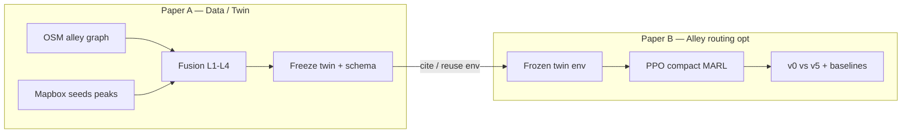

# Hai bài báo (locked) — Quận 4 alley twin

> Định hướng nghiên cứu: **2 conference papers**, claim tách sạch, không salami một kết quả.  
> Repo phục vụ cả hai; artifact & `data_tag` phải đọc được “Paper A freeze” vs “Paper B train”.



---

## Paper A — Alley-aware urban density twin (data)

### Câu hỏi
Làm sao ước lượng / tái tạo trạng thái giao thông **trong mạng hẻm** khi quan sát thưa (Mapbox seed + đồ thị), cam **không** nhìn vào trong hẻm?

### Claim (một câu)
Chúng tôi đề xuất pipeline twin Quận 4: OSM alley identity + WCC train domain + Mapbox time-bucketed fusion + graph interpolation + uncertainty + camera **secondary tại cổng**; phát hành schema/artifact có thể tái lập.

### Đóng góp chính
1. Domain **một WCC alley-core** (tránh graph 370 mảnh).  
2. Fusion **không trộn sáng+tối**; `min_positive≥3`; uncertainty đa mức.  
3. Vai trò cam đúng vật lý: entry/spine only, không `camera_direct` interior.  
4. Limitation trung thực (Mapbox ≠ probe xe máy hẻm hẹp; OSM thiếu hẻm).

### Không phải trọng tâm Paper A
- Bảng regret/acc MARL dài (chỉ smoke / use-case ½ trang nếu cần).  
- So sánh nhiều thuật toán RL.

### Deliverables (freeze = `paper_a_twin`)
| Artifact | Path gợi ý |
|----------|------------|
| WCC graph | `artifacts/out/quan4/wcc/alley_graph_wcc.json` |
| Peak densities | `*_peak_{morning,afternoon,evening}_*_wcc.json` |
| L1 index | `density/density_l1_index.json` |
| Seeds | `ingestion-worker/config/od_pairs.quan4.seeds_l3.json` |
| Cam map (secondary) | `density/cam_node_map.json` + `alley_density_l4_cam*.json` |
| Meta QA | `wcc/l2_wcc_meta.json`, `verify_l3` JSON |
| Docs | [L5_LIMITATIONS.md](./L5_LIMITATIONS.md), [QUAN4_DENSITY.md](./QUAN4_DENSITY.md), [DATA_CONTRACTS.md](./DATA_CONTRACTS.md) |

**data_tag twin (Paper A):** `paper_a_q4_wcc_peaks` (freeze sau khi morning đủ + ≥1 ngày peak lệch rõ nếu được).

### Pass Paper A (trước khi viết camera-ready)
- [ ] ≥2 peak **có observed > 0** (đang: afternoon+evening; **thiếu morning**)  
- [ ] `pass_single_wcc=true`  
- [ ] Observed ≥ ~20% alley trong WCC hoặc ≥300 OD observed  
- [ ] Uncertainty ≥ 3 mức  
- [ ] Afternoon vs evening: báo cáo `|Δk|` / % alley đổi (thành thật nếu nhỏ)  
- [ ] ≥1 hình map `k` theo peak + histogram uncertainty  
- [ ] Limitation section đầy đủ  
- [ ] (Mạnh) validate Mapbox vs mẫu GPS/Google trên vài OD  
- [ ] (Mạnh) ≥2 ngày calendar peak  

### Venue gợi ý
ITSC / hội nghị ITS khu vực / data+applications track; short paper + dataset OK.

### Effort GPU
**0** (Nest + fuse local).

---

## Paper B — Alley-aware routing optimization (MARL)

### Câu hỏi
Trên twin hẻm đã freeze, agent học chọn lộ trình `(t,O,D)` (ưu tiên trục vs hẻm) có giảm thời gian / regret so với baseline không?

### Claim (một câu)
Trên twin Quận 4 đã công bố/đóng băng, compact-obs PPO cải thiện định tuyến qua hẻm so với baseline tĩnh và so môi trường mixed-day v0, với protocol eval cố định.

### Đóng góp chính
1. Env `(t,O,D)` + density catalog theo peak.  
2. Trainer robust (early-stop, val-adapt) — server-friendly logs.  
3. So **v0 (mixed)** vs **v5 (Paper A twin)**; oracle regret; action accuracy.  
4. Ablation nhẹ: Mapbox-only vs +cam_secondary (nếu đủ thời gian).

### Không phải trọng tâm Paper B
- Chi tiết Overpass/OSM tagging (cite Paper A).  
- Thiết kế Nest poller.

### Deliverables
| Artifact | Path / lệnh |
|----------|-------------|
| Config train | `marl_agent/configs/quan4_v5_final.yaml` (`data_tag: v5_l1l5`) |
| Baseline config | `quan4_h100.yaml` (`v0_seed120_mixed_day`) — đã có run |
| Metrics table | `python -m marl_agent.l5_metrics_table …` |
| Runs | `artifacts/out/quan4/marl_runs/…` trên sol1 |

**data_tag train (Paper B):** `v5_l1l5` trên twin Paper A; so với `v0_seed120_mixed_day`.

### Pass Paper B
- [ ] Full train sol1 (không `--smoke`) → `ROBUST_TRAIN_OK`  
- [ ] Bảng v0 vs v5: test_regret, test_action_acc, travel, wall-clock  
- [ ] ≥1 baseline non-RL (oracle đã có; thêm shortest fixed-preference)  
- [ ] Learning curve từ `metrics.jsonl`  
- [ ] Cite twin Paper A / freeze tag  
- [ ] (Optional) SUMO 2–3 route qualitative  

### Venue gợi ý
ITSC / IEEE ITS workshop / RL-for-transportation workshop — không nhắm venue ML top nếu chưa multi-city.

### Effort GPU
**1–2 buổi** sol1 (`CUDA_VISIBLE_DEVICES=1`) sau Paper A freeze.

---

## Quan hệ hai bài (anti-salami)

| Quy tắc | Chi tiết |
|---------|----------|
| A đứng độc lập | Đọc được không cần số MARL |
| B đứng độc lập | Twin là input đóng băng; cite A |
| Không trùng bảng | Map/fusion chỉ A; regret/train chỉ B |
| Một chiều cite | B → A; A không phụ thuộc B |
| Train | **Không** train lại mỗi L; một campaign GPU cho B |

---

## Lịch làm việc (bám 2 paper)

| Tuần | Việc | Paper |
|------|------|-------|
| Now | Poll **morning** + fuse; đo Δk afternoon/evening; (nếu yếu) thêm 1 ngày peak | **A** |
| +0.5 | Freeze twin `paper_a_q4_wcc_peaks` + figures + limitations | **A** |
| +1 | Sync sol1 → train `v5_l1l5` vs v0 → bảng metrics | **B** |
| +1–2 | Ablation cam / draft A rồi B (hoặc song song viết) | A+B |
| Optional | Cam Q4 thật; GPS validate; ngày Mapbox thứ 2 | A mạnh hơn |

### Việc **không** làm
- Train GPU trước khi morning (và ideally Δk) ổn cho claim A.  
- Nhét toàn bộ L1–L5 narrative vào cả hai abstract giống nhau.  
- Coi camera city-wide ngoài Q4 là quan sát trong hẻm Q4.

---

## Mapping pipeline L1–L5 → paper

| Lớp | Paper chính | Ghi chú |
|-----|-------------|---------|
| L1 time buckets | **A** | Cần morning filled |
| L2 WCC | **A** | Đã pass |
| L3 seeds + uncertainty | **A** | Đã pass verify_l3 |
| L4 cam secondary | **A** (method) / B ablation | Placeholder OK nếu nói rõ |
| L5 eval protocol | **B** (+ A limitations doc) | `quan4_v5_final` |
| Train v5 | **B** | Sau freeze A |

---

## Lệnh ngắn (operator)

```powershell
# Paper A — sau poll morning
cd ml-core
python -m data_fusion.run_quan4_density --l1-peaks --min-positive 3 `
  --graph artifacts/out/quan4/wcc/alley_graph_wcc.json `
  --mapbox ..\ingestion-worker\data_raw\mapbox\travel_time_YYYY-MM-DD.csv `
  --output artifacts/out/quan4/density --latest-peak evening
python -m data_fusion.verify_l3 --mapbox ... --density artifacts/out/quan4/density/alley_density_latest.json
python -m data_fusion.cam_secondary_prior --density artifacts/out/quan4/density/alley_density_latest.json
python -m data_fusion.export_wcc_subgraph ... --density <peak files + l4>
python -m data_fusion.paper_a_freeze_check   # exit 0 = ready_to_freeze
```

```bash
# Paper B — sol1 (sau freeze A + sync)
CUDA_VISIBLE_DEVICES=1 python -m marl_agent.robust_train \
  --config marl_agent/configs/quan4_v5_final.yaml --device cuda
python -m marl_agent.l5_metrics_table path/v0/summary.json path/v5/summary.json
```

Chi tiết train: [TRAIN_NOW.md](./TRAIN_NOW.md).  
Env layers: [ENV_UPGRADE_L1_L5.md](./ENV_UPGRADE_L1_L5.md).
